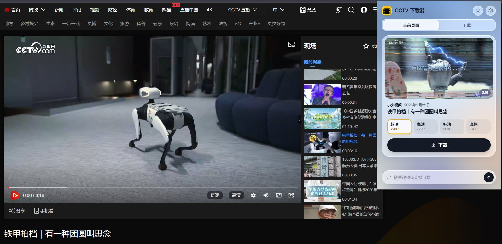
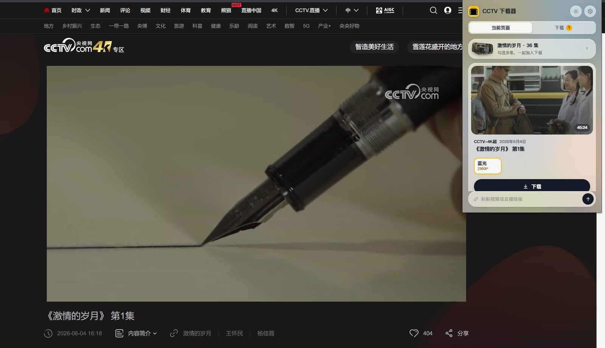
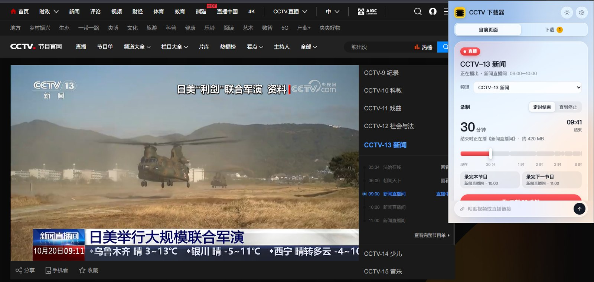
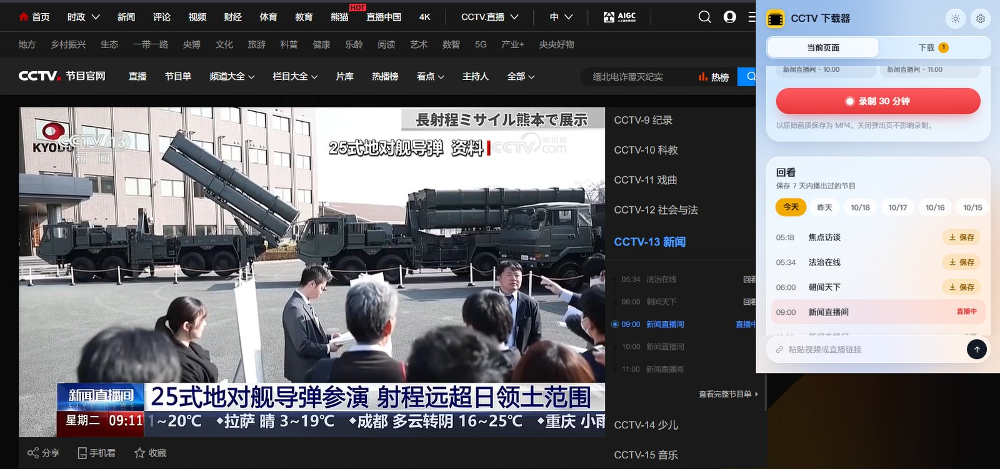
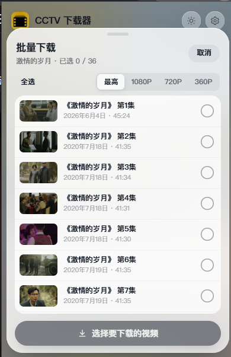
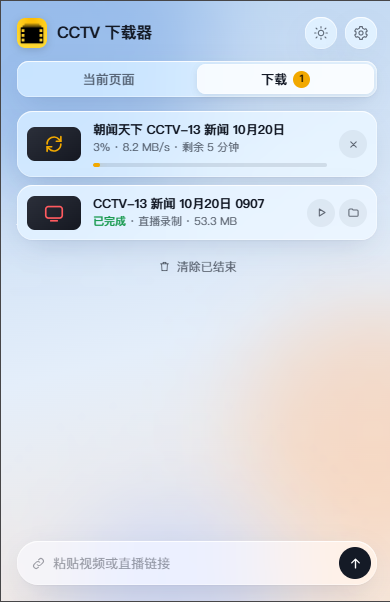
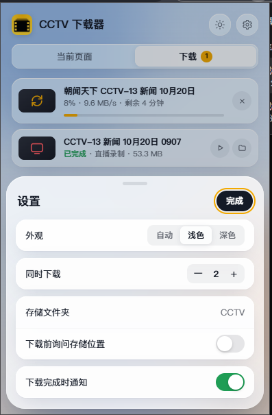
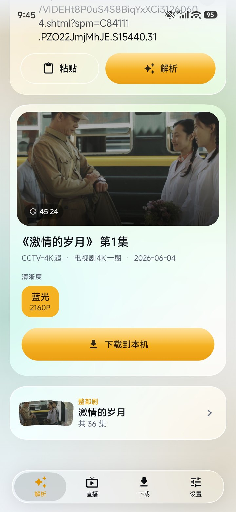
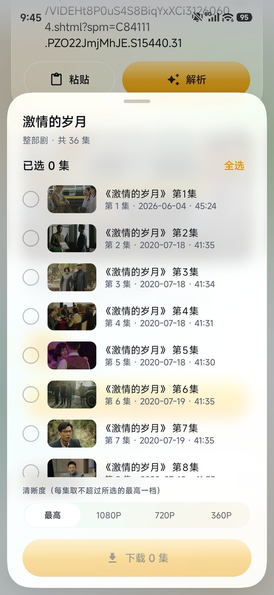
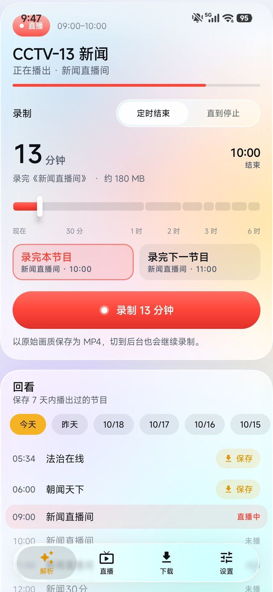

<div align="center">


# CCTV 下载器

**原画下载，原样保存。**

面向央视网的视频下载工具，提供浏览器扩展与 Android 应用

[](#下载安装)
[](#下载安装)
[](#下载安装)
[](#下载安装)
[](https://github.com/cocang/cctv-downloader/releases/latest)
[](LICENSE)

[下载安装](#下载安装) · [主要功能](#主要功能) · [应用截图](#应用截图) · [技术概览](#技术概览) · [项目结构](#项目结构) · [从源码构建](#从源码构建)

</div>

CCTV 下载器可以将央视网（tv.cctv.com 及相关站点）的点播视频、电视剧、栏目合集，以及电视直播与回看节目，以官方提供的最高画质保存为标准 MP4 文件。

全部处理在本地完成：识别页面、解析清单、下载切片、解密与封装均在扩展后台或应用内部进行，不向网页注入脚本，也不依赖任何第三方服务器。

## 下载安装

安装包发布于 **[GitHub Releases](https://github.com/cocang/cctv-downloader/releases/latest)**，请下载对应平台的附件；`Source code` 为源码压缩包。

| 平台 | 安装包 | 安装方式 |
| --- | --- | --- |
| Chrome / Edge 116+ | `*-chromium.zip` | 解压到固定目录，打开 `chrome://extensions`（Edge 为 `edge://extensions`），开启「开发者模式」后加载该目录 |
| Firefox 140+ | `*-firefox.xpi` | 未经 Mozilla 签名，可在 `about:debugging` 中临时加载；Developer Edition / Nightly 关闭签名校验后可正式安装 |
| Android 8.0+ | `*.apk` | 直接安装，首次安装需允许「安装未知应用」 |

## 主要功能

### 浏览器扩展

- **视频下载**：打开视频页即可识别，按清晰度列出可用版本，支持 4K 专区的 2160P 蓝光画质
- **剧集与栏目**：自动识别电视剧、纪录片与栏目合集，按集数排列，可勾选多集批量下载并统一清晰度
- **直播录制**：支持央视各频道及慢直播；可「直到停止」，也可在节目时间轴上设定结束点，拖动时自动吸附节目边界，并预估时长与文件大小；录制中可随时延长
- **回看保存**：按日期浏览近 7 天节目单，单个节目一键保存
- **下载管理**：多任务并行，实时显示速度与剩余时间，网络波动时自动重试；完成后可直接播放或打开所在文件夹
- **质量校验**：下载完成后自动进行结构检查与抽样解码，异常会在任务列表中提示
- **界面体验**：浅色 / 深色 / 跟随系统；工具栏图标显示总进度，完成后发送系统通知
- **粘贴解析**：无需打开页面，粘贴视频或直播链接即可解析

### Android 应用

Android 版与扩展共用同一套下载引擎，具备视频、剧集、直播录制与回看等全部核心功能，并针对移动端重新设计：界面采用 Jetpack Compose 构建，在 Android 13 及以上呈现液态玻璃质感，较低版本则自动采用模糊或半透明材质；支持从浏览器或其他应用直接分享链接解析；下载在前台服务中持续进行，文件可保存至「下载」、相册或自定义目录，并提供命名规则、同名处理与完整性校验。

## 应用截图

### 浏览器扩展

<table>
  <tr>
    <td align="center" width="50%"><strong>视频下载</strong><br /><a href="docs/screenshots/extension-video.jpg"></a></td>
    <td align="center" width="50%"><strong>4K 剧集</strong><br /><a href="docs/screenshots/extension-4k-series.jpg"></a></td>
  </tr>
  <tr>
    <td align="center" width="50%"><strong>直播录制</strong><br /><a href="docs/screenshots/extension-live.jpg"></a></td>
    <td align="center" width="50%"><strong>回看保存</strong><br /><a href="docs/screenshots/extension-replay.jpg"></a></td>
  </tr>
</table>

<table>
  <tr>
    <td align="center" width="33%"><strong>批量下载</strong><br /><a href="docs/screenshots/extension-batch.png"></a></td>
    <td align="center" width="33%"><strong>下载管理</strong><br /><a href="docs/screenshots/extension-downloads.png"></a></td>
    <td align="center" width="33%"><strong>设置</strong><br /><a href="docs/screenshots/extension-settings.png"></a></td>
  </tr>
</table>

### Android 应用

<table>
  <tr>
    <td align="center" width="33%"><strong>视频下载</strong><br /><a href="docs/screenshots/app-video.jpg"></a></td>
    <td align="center" width="33%"><strong>剧集下载</strong><br /><a href="docs/screenshots/app-episodes.jpg"></a></td>
    <td align="center" width="33%"><strong>直播与回看</strong><br /><a href="docs/screenshots/app-live.jpg"></a></td>
  </tr>
</table>

<p align="center"><sub>点击图片可查看原图。</sub></p>

## 技术概览

- **点播解密**：h5e 解密算法移植自开源项目 [letr007/CCTVVideoDownloader](https://github.com/letr007/CCTVVideoDownloader)，在此基础上以纯 JavaScript 重写，并修正了切片头注入位、IDR 帧末尾单元格判定、防竞争字节处理与 RBSP 读取偏移等边界问题；解密以流式逐 NAL 进行，处理长视频时内存占用保持平稳。
- **直播解密**：直播与回看流复用官方播放器的解密模块，经隔离改造后可在扩展与应用中独立运行，输出与官方播放器逐字节一致。
- **下载调度**：自适应并发（AIMD）、慢请求对冲与指数退避重试，各任务共享连接配额；直播录制支持主备线路自动切换。
- **封装输出**：TS 切片合并后直接封装为 MP4，边下载边写入，无需转码。
- **测试验证**：已对 **51 个视频**的全部清晰度完成验证，**解码零错误**；仓库附带离线回归测试，便于复现。

## 项目结构

```text
cctv-downloader/
├── extension/                  浏览器扩展（Chrome / Edge / Firefox）
│   ├── src/
│   │   ├── manifest.json
│   │   ├── background.js       后台入口：页面识别、消息接口、任务调度
│   │   ├── core/               下载引擎（扩展与 Android 共用）
│   │   ├── offscreen/          离屏文档：文件导出与解码校验
│   │   ├── platform/           Firefox 适配层
│   │   ├── popup/              弹出页界面
│   │   ├── lib/                第三方库（mux.js）
│   │   └── assets/             图标
│   ├── build/                  多浏览器构建与模块生成脚本
│   ├── tests/                  回归测试与样本
│   └── package.json
├── android/                    Android 应用（Kotlin + Jetpack Compose）
│   ├── app/src/main/
│   │   ├── java/…/cctvdl/      界面、下载服务、本地引擎宿主与文件存储
│   │   └── assets/web/         引擎宿主脚本（构建时自动同步 extension/src/core）
│   ├── app/src/test/           Robolectric 启动与界面测试
│   └── build.gradle
├── docs/screenshots/           README 截图
├── .github/workflows/          持续集成
└── LICENSE
```

## 从源码构建

**浏览器扩展**（需要 Node.js 18+）

```bash
cd extension
npm test              # 离线回归测试
npm run build         # 输出 dist/chrome 与 dist/firefox
```

**Android 应用**（需要 JDK 17+ 与 Android SDK 36）

```bash
cd android
./gradlew assembleRelease
```

未提供签名配置时，release 包使用调试签名。如需正式签名，请在 `android/keystore.properties` 中填写 `storeFile`、`storePassword`、`keyAlias`、`keyPassword`（该文件不会被提交）。

## 使用须知

- 本项目仅供学习与技术交流参考，下载内容的版权归央视网及相关权利人所有，请勿用于商业用途或公开传播。
- 本项目依赖央视网的现有接口与加密方案，源站一旦调整便可能**随时失效**，且不保证持续维护。如有长期使用需求，建议 **Fork 后自行维护**。

## 致谢

- [letr007/CCTVVideoDownloader](https://github.com/letr007/CCTVVideoDownloader)：h5e 解密算法的原始实现
- [woliubang256/kudo-android](https://github.com/woliubang256/kudo-android)（酷Do）：Android 应用界面设计参考
- [Kyant0/AndroidLiquidGlass](https://github.com/Kyant0/AndroidLiquidGlass)：液态玻璃效果库 Backdrop
- [videojs/mux.js](https://github.com/videojs/mux.js)：MP4 封装

## 开源许可

本项目以 [GNU GPL v3](LICENSE) 发布（解密部分源自 GPL v3 项目，整体沿用同一许可）。欢迎自由使用、修改与分发，衍生作品请同样保持开源。

部分界面组件改编自 Apache License 2.0 项目，原始版权声明保留在对应源文件中。

## 🔗 友情链接

[LINUX DO](https://linux.do/) —— 真诚、友善、团结、专业的技术社区
